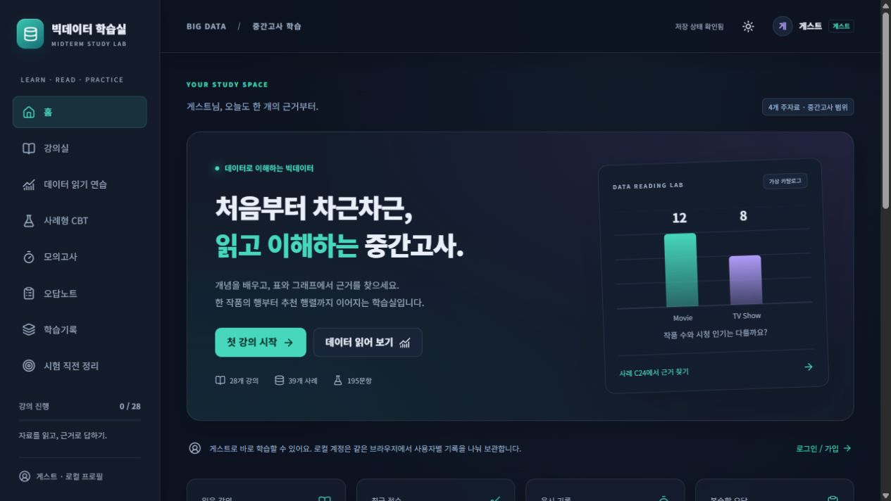

# GitHub Pages 공개 배포 검증

## 2026-10-18 장별 페이지 통합

게시 대상은 기존 GitHub HTTPS 주소 `https://insuham0315.github.io/BigData_CBT/`입니다. A~H 각 한 페이지와 메뉴 전체 접기/펼치기를 적용하며, 도메인·Vite base·저장 키는 바꾸지 않습니다. 수동 배포 워크플로는 기존 콘텐츠·계산·단위·빌드 검사에 격리 Chromium의 장별/모바일/메뉴/백업 검사를 추가했습니다. 소스 push만으로 배포하지 않는 기존 방식을 유지합니다.

장별 주소는 `#/lessons/chapter/A`~`#/lessons/chapter/H`, 기존 단원 링크는 장 내부 위치로 연결합니다. 공개 배포 성공은 [Pages 실행 기록](https://github.com/InsuHam0315/BigData_CBT/actions/workflows/pages.yml)에서 해당 커밋의 build/deploy 결과로 확인하며, 게시된 HTML·자산을 로컬 검증 빌드와 비교합니다. 아래 날짜별 항목은 이전 배포 이력입니다.

## GitHub 기본 HTTPS 주소로 임시 복구 · 2026-10-17

사용자 요청에 따라 인증서 발급이 `bad_authz`로 멈춘 커스텀 도메인 연결을 잠시 해제하고 `https://insuham0315.github.io/BigData_CBT/`로 복구합니다. Vite base는 `/BigData_CBT/`이며 현재 수동 배포 워크플로를 유지합니다. 내도메인.한국의 DNS 레코드, 강의·문항·채점, 기존 학습 DB와 저장 키를 변경하지 않습니다. 아래는 커스텀 도메인에서 수행한 이전 검증 기록입니다.

## HTTPS·로컬 계정 재검증 · 2026-10-17

가상 검증 계정으로 production 미리보기(127.0.0.1:4173)에서 가입, 로그아웃, 잘못된 비밀번호 거부, 재로그인, 새로고침 후 세션 복원을 실제 Chrome 화면에서 확인했습니다. 콘솔 오류·경고 0개. 개인 계정과 학습 기록은 변경하지 않았습니다. HTTP/암호화 API 미지원 상황에서는 입력과 제출을 비활성화하고 HTTPS 안내를 표시하며, 저장소 API도 계정 조회 전에 연결 상태를 확인합니다. 이 상황을 잘못된 비밀번호로 표시하지 않는 회귀 테스트 2개를 추가했고 총 20개 테스트, 콘텐츠 검사와 TypeScript·빌드가 통과했습니다. 기존 PBKDF2 방식과 저장 키는 유지합니다.

공개 도메인의 CNAME·A·AAAA·CAA와 Pages DNS 검사는 정상입니다. 동일 도메인 연결을 잠시 해제했다가 복구해 인증서를 재요청했지만 GitHub가 `bad_authz`를 다시 반환했습니다. 공개 HTTPS의 가입·로그인 검증은 유효한 인증서가 발급된 뒤 별도로 수행해야 합니다. 인증서 확인에 실패한 연결을 우회하지 않습니다.

## 커스텀 도메인 경로 수정 · 2026-10-17

현재 도메인은 `ist-bigdata.kro.kr`, CNAME 대상은 `insuham0315.github.io`입니다. 저장소 Pages의 Custom domain도 `ist-bigdata.kro.kr`로 연결합니다. 기존 `/BigData_CBT/` 경로의 JS·CSS 7개가 도메인 루트에서 404를 반환하는 문제를 확인하여 Vite base를 `/`로 변경했습니다. `VITE_BASE_PATH`로 필요할 때 다른 경로를 지정할 수 있습니다.

강의·사례·문항·선지 ID, 채점과 사용자 저장 키는 이번 변경에서 수정하지 않습니다. 같은 수동 `workflow_dispatch` 워크플로로 검사·빌드·배포하며 소스 push만으로 자동 게시하지 않습니다. HTTPS 인증서 상태는 배포와 별도로 확인합니다. 도메인/HTTP/HTTPS 출처별 로컬 기록은 독립적이며 JSON 백업으로 이전합니다. 아래는 이전 배포 당시의 기록입니다.

2026-10-12 공개 배포 요청에 따라 수행했다.

- 공개 주소: [빅데이터 학습실](https://insuham0315.github.io/BigData_CBT/)
- 호스트: `insuham0315.github.io`. 참고한 소웨공 사이트와 같은 계정 서브도메인에서 `/BigData_CBT/` 프로젝트 경로를 제공한다.
- 저장소/브랜치: `InsuHam0315/BigData_CBT`, `codex/bigdata-midterm-cbt`.
- 방식: GitHub Pages `build_type=workflow`, HTTPS 강제, 수동 GitHub Actions.
- 첫 공개 배포 콘텐츠 기준: [fdd40baac9ed57e871f21e2457f6458c75d53fd2](https://github.com/InsuHam0315/BigData_CBT/commit/fdd40baac9ed57e871f21e2457f6458c75d53fd2). 아래 표는 이 첫 배포의 검증 결과다. 이후 글씨 크기 개선 검증은 [기능 검증 문서](functional-tests.md), 최신 반영 버전은 [작업 브랜치](https://github.com/InsuHam0315/BigData_CBT/tree/codex/bigdata-midterm-cbt)와 [Pages 실행 기록](https://github.com/InsuHam0315/BigData_CBT/actions/workflows/pages.yml)을 확인한다.
- [배포 실행 38265693195](https://github.com/InsuHam0315/BigData_CBT/actions/runs/38265693195): completed / success. 빌드 및 배포 job 모두 success.

| 검사 | 결과 |
|---|---|
| GitHub Linux / Node 22 `npm ci` | PASS |
| GitHub 콘텐츠 검사, 17개 테스트, production 빌드 | PASS |
| 인증 없이 공개 HTTPS GET | HTTP 200, 학습실 HTML 제목 확인 |
| CSS·앱·runtime·콘텐츠·vendor 자산 | 5개 모두 HTTP 200, 각 SHA-256이 검증한 로컬 빌드와 일치 |
| 앱 브라우저 홈 | 28강의·39사례·195문항 및 메뉴 정상 표시 |
| H4 직접 링크와 새로고침 | 회귀·Ridge·학습/테스트·MAE 강의와 자산 정상 |
| C24 구성비 보기 | Movie 60%, TV Show 40%, 분모 20 표시 |
| 자료 → CBT | C24 필터·5문항·자료/사례 연결 정상 |
| 브라우저 콘솔 | 오류/경고 0 |

정적 배포 파일은 `dist`의 HTML·CSS·JavaScript만 포함한다. 원본 PDF, 로컬 인증 DB, 개인 학습 기록, 백업, API 토큰은 포함하지 않았다. GitHub API용 작업 스크립트는 무시되는 로컬 임시 경로에만 두었으며 인증값을 파일이나 로그에 기록하지 않았다.

사이트 접속은 공개 네트워크에서 가능하다. 회원가입/로그인과 기록 저장은 기존 명세대로 각 브라우저의 IndexedDB를 사용하며 서버 계정·기기 간 자동 동기화는 제공하지 않는다. 로컬 주소에서 사용하던 기록은 백업 내보내기/가져오기로 명시적으로 이전할 수 있다.

## 이전 전체 강의 보강 버전 · 2026-10-13

같은 Pages 주소와 `codex/bigdata-midterm-cbt` 브랜치를 사용한다. 28강의의 본문 약 4.2배, 39개 연결 풀이, 28개 실행 검증 코드, 84개 추가 자가 점검을 포함한다. [강의별 보강 검증](lesson-upgrade.md)에 범위·출력·브라우저 확인을 기록했다. 최신 반영 SHA와 배포 성공 여부는 [Pages 실행 기록](https://github.com/InsuHam0315/BigData_CBT/actions/workflows/pages.yml)의 해당 실행에서 확인할 수 있다.

Pages 빌드는 Python 3.12에서 28개 코드 출력과 기존 39개 정답/9개 변환을 검산하고 콘텐츠 검사·17개 테스트·production 빌드를 수행한다. 콘텐츠를 강의/사례/문항 파일로 나누어 큰 단일 번들을 줄였다. 배포 반영 확인은 공개 HTML과 자산 7개의 HTTP 200 및 로컬 `dist`와의 SHA-256 일치, 실제 강의 화면의 보강 내용 확인으로 수행한다. 기존 로그인·학습 기록의 저장 계약과 CBT 대상 ID는 유지한다.

## 수업 범위·종합 회차·전체 메뉴 개편 · 2026-10-13

이전 보강 구성을 수업 중심의 28강의·112섹션·6개 코드 입출력 예제로 교체했다. 39개 사례 풀이·84개 자가 점검·기존 대상 ID는 유지한다. 종합 회차는 1~5회차, 각 50문항·10자료이며 195개 고유 문항 전체를 포함한다. 모든 메뉴의 하위 항목과 실제 세부 화면을 제공한다.

Pages 빌드는 6개 코드 출력, 39개 수치 정답·9개 변환, 콘텐츠 검사, 18개 테스트, production 빌드를 수행한다. 최신 실행은 [Pages 배포 기록](https://github.com/InsuHam0315/BigData_CBT/actions/workflows/pages.yml)에서 확인한다. 로컬 검증은 [개편 안내](lesson-upgrade.md), [기능 검증](functional-tests.md), [117개 세부 화면 검사](lesson-browser-validation.json)에 기록했다. 공개 반영은 배포 성공 후 HTML과 7개 자산의 HTTP 응답·SHA-256, 실제 메뉴와 회차 화면으로 확인한다.
