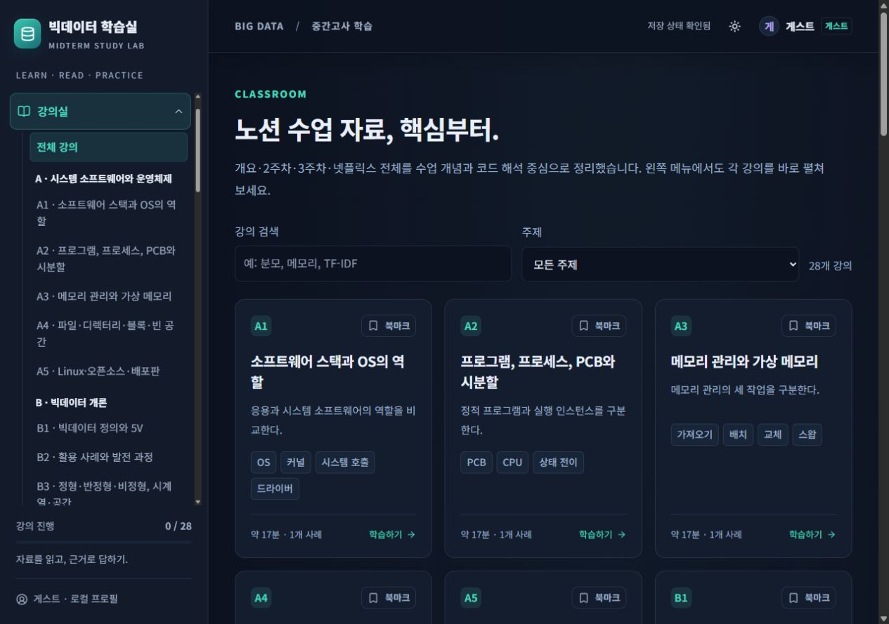
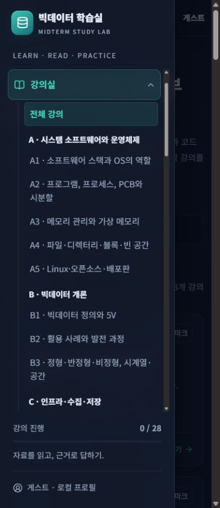
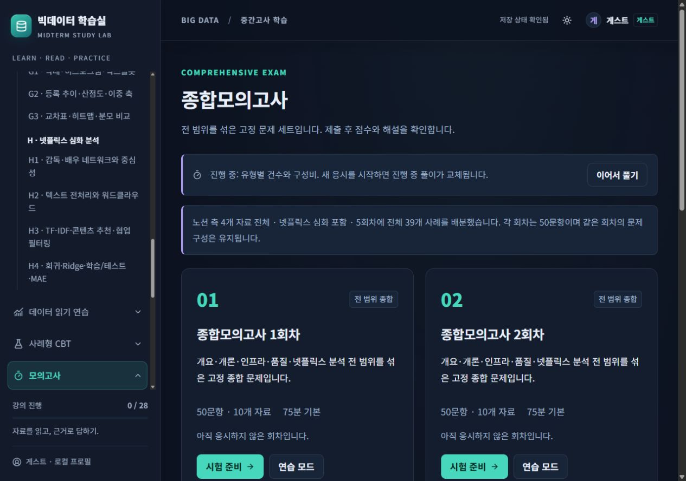
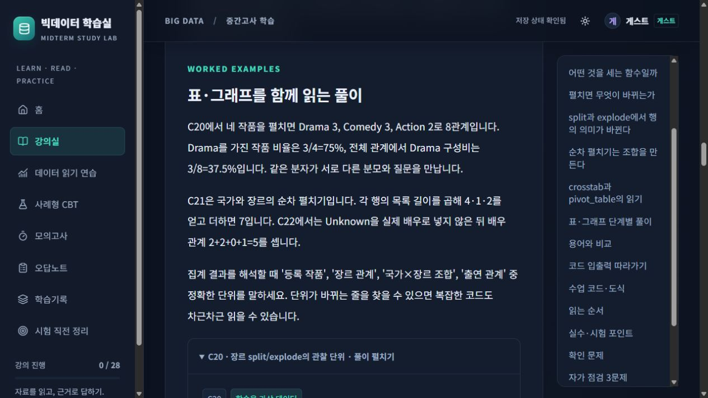
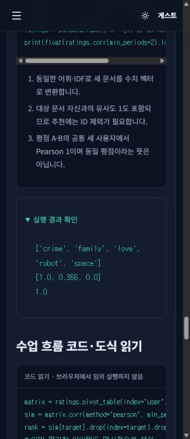
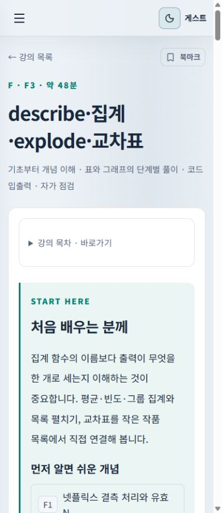

# 기능·브라우저 검증

## 2026-10-18 장별 페이지·메뉴 전체 토글

- 기존 A~H 8개 주제를 각 한 페이지로 통합했습니다. 28개 단원, 본문 112절·자가 점검 84개·코드 실행 예제 6개·가상 사례 39개·195문항과 기존 회차 JSON은 작업 전후 동일합니다.
- 단원/문항/선지/북마크/백업 ID와 DB·세션 키를 보존했습니다. 기존 `/lessons/A1`~`/lessons/H4`는 해당 장 안의 단원으로 이동하고 왼쪽 장 메뉴를 활성 표시합니다. 장 전체 완료·해제는 기존 단원 상태를 사용자별 단일 트랜잭션으로 갱신합니다.
- `npm test`: 총 22개 통과. 추가 검사는 다른 장·다른 사용자·기존 생성 시각 보존, 북마크 동시 저장, 기존 백업 형식의 복원입니다. 콘텐츠 검증과 TypeScript/production 빌드도 통과했습니다.
- 격리 Edge: 320·390·768·1440px 각 89개 메뉴 경로(356개)와 장 8개를 검사했습니다. 가로 넘침 0px, 페이지·콘솔·리소스 오류 0. 28개 기존 강의 주소 전부 및 대표 주소의 다른 화면 폭 재검사(34건) 통과.
- 각 장의 단원 전체·본문 개수·중복 DOM ID 부재, 코드/자가 점검/가상 사례 펼침, 주제별 문제 연결, 이전 단원 백업 가져오기, 장 전체 완료 상태를 확인했습니다.
- 데스크톱의 메뉴 숨김·본문 확장·키보드 조작·포커스 복귀·새로고침 후 상태 유지, 모바일의 Escape·배경 닫기·포커스 순환을 확인했습니다. 실제 Chrome 화면에서도 넷플릭스 장의 4개 단원 동시 표시와 전체 메뉴 접기를 확인했습니다.
- 모바일의 긴 기술 용어 줄바꿈을 보완하고, 브라우저의 기본 아이콘 요청 오류를 없애도록 앱 아이콘을 지정했습니다. 실제 개인 계정·백업·학습 DB를 검사에 사용하지 않았습니다. 화면/세부 결과는 무시되는 `test-results`에 보관합니다.

검증일: 2026-10-12. Windows, Node 24.18.0, Codex 앱 내 브라우저. 실제 UI 조작과 Vitest/fake-indexeddb 테스트를 구분해 기록한다. 화면은 가상 A/B 계정·가상 데이터만 사용했다. 인증 레코드와 백업 파일 자체는 저장소에 포함하지 않았다.

## 자동 검사

| 검사 | 결과 |
|---|---|
| `npm ci` 잠금 파일 클린 재설치 | 서버 종료 후 PASS, audit 취약점 0 |
| `npm run validate` | 7자료, 28강의, 39사례, 195문항, 주자료 근거/페이지/ID/단일 정답/모의 배분 PASS |
| 독립 Python/Pandas/NumPy | 숫자 39개 및 전처리·분포·추천·상관·MAE 출력 확인 PASS |
| `npm test` | 2파일, 17테스트 PASS |
| `npm run build` | strict TypeScript + production 빌드 PASS, 번들 크기 경고 없음 |

Vitest는 선지 ID와 섞기, 숫자 오차/0/잘못된 단위 문자열, 짧은 답/서술, 3모의고사 균형·사례 연속·중복 없음, 빈/부족한 풀, 미응답, PBKDF2·salt·아이디 중복·틀린 비밀번호, A/B 동시 쓰기, 초안 복원, 제출 중복, 오답 횟수/재정답 해결, 만료 후 입력 차단, 오래된 draft 콜백, 서술 평가, 백업 소유자 재지정·중복·잘못된 형식·점수 재계산, 게스트 명시 이전, 저장 트랜잭션 실패 롤백을 검사한다.

## 실제 브라우저

| 시나리오 | 관찰 결과 |
|---|---|
| 강의 A1 → 읽기 완료·북마크 → C01 5문항 | 진도 1/28, 강의 북마크, 연결 사례·자료 표시 |
| 객관식 오답 + 검토/문제 북마크 후 새로고침 | 같은 선지 순서·선택·검토·문제 ID 복원 |
| 연습 문항 확인 | 확인 전 해설 없음, 확인 후 선지별 이유·계산·연결 강의 표시 |
| 숫자 10ms, 짧은 답 `20`, 서술 작성 | 수치/용어 정답. 서술은 평가 대기 → 자기 평가 100점으로 확정 |
| 전체 제출, 미응답 | C01 1/5 정답 20점, 4개 고유 오답. 미응답 정책 표시 |
| 오답 검색 → 연결 강의 | C01-Q1 검색 후 A1로 이동. 자료·선택 답·정답·이유·재풀이/해결 버튼 |
| A 가입 + 선택한 게스트 이전 | 게스트 응시 1회·진도 1·북마크 2개 복원 |
| 별도 탭 B 가입(이전 선택 안 함) | 응시/진도/오답/북마크 모두 0. A 탭 로그인 유지 |
| B F1 완료·북마크 | B만 변경. A 진도/북마크에 F1이 섞이지 않음 |
| 중복 아이디 / 틀린 비밀번호 | 구체적인 오류, 기존 사용자/기록 유지 |
| A↔B 전환, 로그아웃/재로그인 | 각각의 기록 복원, 게스트 세션 전환, A/B 탭 독립 유지 |
| A 모의고사 40문항·1분 | A~H 범위, 확인 버튼/해설 없음, 재로드 종료 시각·선지/답안 유지 |
| 실제 60초 만료 | 자동 제출: 1/40, 3점, 시간 만료 표시. 재로드 후 A 응시 총 2회(중복 없음) |
| JSON 내보내기 | 최상위 app/schemaVersion/exportedAt/profile만. salt/verifier/password 없음 |
| A의 이전 백업을 B에 명시적으로 합치기 | B 1응시/2강의/3북마크, A 2응시/1강의/2북마크 그대로 |
| 결측 대체+삭제 | C18 a,b,e 3행, 감독 Unknown 표시. 단순 그림 교체가 아닌 행 변환 |
| 다중값 펼치기 | C20 8관계 행/4고유 작품. Drama 3/Comedy 3/Action 2 |
| 건수↔구성비 | C24 Movie 60%, TV Show 40%, 분모 20 |
| 표 정렬/검색·확대 | 열 정렬/행 검색 제공. 확대 Escape 닫힘, Tab 포커스 순환·복귀 |
| 대표 차트 11개 | 막대·히스토그램·박스·선·산점·히트·이중 축·네트워크·워드클라우드 모두 SVG/대체 표 표시 |
| 390px 모바일·다크/라이트 | 문제/자료 전환, 한글·입력·표 표시, 페이지 가로 넘침 수정 후 없음 |
| 같은 주소에서 서버 재시작 | B C36 초안 답 1.5·검토·로그인 복원, A 기록 그대로 |
| Production `/BigData_CBT/#/lessons/H4` 새로고침 | 강의/자산 정상. 8개 메뉴 모두 이동, 브라우저 오류/경고 0 |

## 발견 후 수정

- 중복 아이디가 일반 저장 오류로 보이던 트랜잭션 오류 처리 수정.
- 같은 PDF를 여러 범위로 참조할 때 React 중복 key 수정.
- 개발 중 Context hot reload의 객체 정체성 문제: 객체 분리와 화면 공용 모듈의 순환 참조 제거, 재로드/production 확인.
- 객관식 기본 선지에서 정답 위치가 한쪽에 몰리지 않도록 안정적 순환 배치(정답 ID 유지).
- 모바일 공통 자료가 504px로 넓어지던 grid 최소 너비 문제 수정. 390px viewport에서 document 너비 375px, 가로 넘침 없음.
- 빈 변환 버튼 패널 제거, 라이트 버튼/워드클라우드 텍스트 대비, 확대 키보드 포커스 개선.
- Windows `npm ci`가 실행 중인 Rolldown 파일 잠금으로 실패: 작성한 서버만 종료해 클린 재설치·검사 후 동일 포트로 재시작.

## 캡처

[홈 다크](screenshots/home-dark.jpg), [강의](screenshots/lesson-dark.jpg), [풀이](screenshots/quiz-dark.jpg), [시간 만료 결과](screenshots/result-expired.jpg), [기록](screenshots/records-dark.jpg), [읽기](screenshots/reading-dark.jpg), [이중 축 다크](screenshots/reading-dual-dark.jpg), [라이트](screenshots/reading-light.jpg), [모바일 읽기](screenshots/reading-mobile-light.jpg), [모바일 문제](screenshots/quiz-mobile-light.jpg), [모바일 자료](screenshots/quiz-material-mobile-light.jpg).

## 검증의 한계

브라우저 저장소 용량 부족·시크릿 모드·사용자가 저장소 접근을 막는 모든 OS/브라우저 조합을 실제로 재현하지는 않았다. 트랜잭션 실패 롤백과 화면 오류 경로를 구현·자동 검사했다. 앱 내 브라우저 외 Safari/Firefox, 스크린리더 장치 전수 검증은 하지 않았다.

원본 CSV의 전체 분석/회귀 학습 결과는 실행하지 않았으며 이를 실제 Netflix 검증값으로 주장하지 않는다. 지정 PDF의 기술 오류·불확실 수치는 주의사항으로 분리했다. 최초 구현 검증에서는 수동 워크플로와 로컬 production 하위 경로를 검증했다. 이후 공개 배포 요청에 따라 GitHub Pages도 배포·실접속 검증했으며 [공개 배포 검증](deployment.md)에 결과를 기록했다.

## 글씨 크기 개선 검증 — 2026-10-13

전체 화면의 고정 글씨 크기 177곳과 반응형 홈 제목을 키웠다. 기본 14→17px, 메뉴 13→16px, 강의 카드 제목 17→20px·설명 12→15px, 본문 15→18px, 표/코드 12→15px다. 모바일 강의 본문은 14→17px, 코드는 11→14px로 키웠다. 행간은 유지해 줄 사이 공간도 함께 넓어진다.

메뉴가 좁아지지 않도록 사이드바 너비를 화면별로 조정하고 세로 스크롤을 허용했다. 390px에서 모바일 메뉴 열기/강의실 이동과 라이트 테마 전환을 실제 UI로 확인했다.

- 1366/1024/768/390/360px의 홈·강의 목록 10조합에서 페이지 가로 넘침 없음.
- 1366/390px에서 강의 본문·자료 읽기(C36)·CBT 설정(C24)·모의고사·기록·계정·오답·시험 직전 정리 16조합에서 페이지 가로 넘침 없음.
- 1873px에서 강의 목록 3열, 제목 20px·설명 15px·메뉴 16px 확인.
- 390px 실제 C24 풀이: 문제 23px·숫자 입력 18px, 공통 자료의 표 15px 확인. 다크/라이트에서 페이지 가로 넘침 없음.
- 브라우저 오류/경고 0, strict TypeScript/production 빌드 PASS.

[커진 글씨 — 데스크톱 다크](screenshots/typography-desktop-dark.jpg), [모바일 라이트](screenshots/typography-mobile-light.jpg).

## 전체 강의 보강 검증 — 2026-10-13

28강의 각각의 6개 설명 섹션·사례 풀이·독립 코드·3개 자가 점검을 데스크톱과 390px 모바일에서 전수 렌더링 확인했다. 모든 강의에서 페이지 가로 넘침이 없다. 긴 HDFS 공식 문서 URL의 모바일 넘침을 발견해 줄바꿈을 수정한 뒤 재확인했다. 코드는 별도 컨테이너 안에서 가로 스크롤되고 키보드로 초점을 줄 수 있다. 긴 용어 설명은 표 안에서 줄바꿈된다.

H4의 코드 출력 펼치기와 자가 점검 정답을 Enter로 펼치기, H4→H3 선수 강의 링크, H3의 모바일 목차 이동·평점 표 추가 펼치기·TF-IDF 출력, F3의 라이트/다크 전환을 확인했다. 기존 로컬 게스트의 C24 미응답 초안이 새 빌드 새로고침 뒤에도 홈에 표시됨을 확인했다. 실사용 개인 계정·기록은 열거나 수정하지 않았다.

28개 Python 실습(실제 TF-IDF·Pipeline/Ridge 포함)의 지정 출력이 일치했다. 기존 CBT 콘텐츠와 ID의 의미적 SHA-256을 유지했고, 기존 숫자 39개+출력 9개의 독립 검산, 17개 자동 테스트, 콘텐츠 검사, 빌드가 통과했다. GitHub Pages 배포에서도 동일 검산을 실행하도록 구성했다. 아래 후속 개편이 이 강의 구성과 회차 설정을 교체한다.

## 수업 중심·종합 회차·전체 메뉴 개편 · 2026-10-13

현재 구성을 production 미리보기 `127.0.0.1:4173/BigData_CBT/`에서 확인했다. 기존 게스트 기록을 합치거나 덮어쓰지 않고 가상의 로컬 검증 프로필을 사용했다. 검증 뒤 게스트로 돌아왔다. 가상 계정 DB·학습 백업은 커밋하지 않는다.

| 검사 | 결과 |
|---|---|
| 28강의 | 각 4개 설명 섹션·3개 자가 점검, 실행 예제는 지정한 6강의에만 표시 |
| 9개 메뉴 토글 | Enter로 펼침·접힘과 aria-expanded 복원, 다른 메뉴 독립 유지 |
| 117개 하위 경로 | 1280×900 / 390×900 전수 렌더링, 제목 표시, 가로 넘침 0 |
| 메뉴 스크롤 | 현재 항목으로 이동, 전체 목록 화면에서는 부모 제목도 표시, 진도·프로필 고정 |
| 모바일 | 메뉴 펼침, Escape 닫기, 주제 하위 링크 이동 시 닫기 |
| 종합 목록 | CBT·모의 5회차, 단원 출제 필터 없음, 회차당 50문항·10자료 |
| 종합 연습 1회차 | 50개 번호, 숫자 답안 저장·새로고침 복원, 6번에서 다음 사례 C10으로 전환, 전체 제출·주제별 결과 |
| 종합 시험 2회차 | 50개 번호, 시험 시간 설정, 문항별 확인 버튼 없음, 새로고침 복원, 제출 후 해설 |
| 기록 세부 화면 | 진도 28행·읽기 완료 1개, 두 응시의 결과, 취약점, C24-Q1 북마크 |
| 오답 보기 | 해결 표시 후 해결 페이지에 1개 표시, 다른 상태별 화면 정상 |
| 코드/자가 점검 | H4 출력과 자가 점검을 Enter로 펼침 |
| 콘솔 | 앱 경고·오류 0 |
| 자동 검사 | 18테스트, 6코드 출력, 39수치 정답·9변환 출력, 스키마/근거/종합 범위, TypeScript·Vite 빌드 PASS |

검사 데이터는 [lesson-browser-validation.json](lesson-browser-validation.json)에 있다. 구조·렌더링 검사는 모든 문장을 교육 전문가가 검토했다는 의미는 아니다. 기존 저장·백업·소유자 테스트를 유지하며 종합 회차의 전 범위 포함·중복 방지·사례 연속·195문항 전체 커버리지 검사를 추가했다.

[강의별 출력 검산](lesson-validation.json), [브라우저 검사 데이터](lesson-browser-validation.json), [상세 보강 내역](lesson-upgrade.md).

